# Лабораторная работа № 1

**Салабай Даниил, группа ИТ-2**

---

## Оглавление

- [Задание 1](#задание-1)
  - [Задача 1. Сумма знаков](#задача-1-сумма-знаков)
  - [Задача 2. Есть ли позитив](#задача-2-есть-ли-позитив)
  - [Задача 3. Большая буква](#задача-3-большая-буква)
  - [Задача 4. Делитель](#задача-4-делитель)
  - [Задача 5. Многократный вызов](#задача-5-многократный-вызов)
- [Задание 2](#задание-2)
  - [Задача 1. Безопасное деление](#задача-1-безопасное-деление)
  - [Задача 2. Строка сравнения](#задача-2-строка-сравнения)
  - [Задача 3. Тройная сумма](#задача-3-тройная-сумма)
  - [Задача 4. Возраст](#задача-4-возраст)
  - [Задача 5. Вывод дней недели](#задача-5-вывод-дней-недели)
- [Задание 3](#задание-3)
  - [Задача 1. Числа наоборот](#задача-1-числа-наоборот)
  - [Задача 2. Степень числа](#задача-2-степень-числа)
  - [Задача 3. Одинаковость](#задача-3-одинаковость)
  - [Задача 4. Левый треугольник](#задача-4-левый-треугольник)
  - [Задача 5. Угадайка](#задача-5-угадайка)
- [Задание 4](#задание-4)
  - [Задача 1. Поиск последнего значения](#задача-1-поиск-последнего-значения)
  - [Задача 2. Добавление в массив](#задача-2-добавление-в-массив)
  - [Задача 3. Реверс](#задача-3-реверс)
  - [Задача 4. Объединение](#задача-4-объединение)
  - [Задача 5. Удалить негатив](#задача-5-удалить-негатив)

---

# Задание 1

## Задача 1. Сумма знаков

### Текст задачи

Дана сигнатура метода: `public int sumLastNums (int x);`

Необходимо реализовать метод таким образом, чтобы он возвращал результат сложения двух последних знаков числа, предполагая, что знаков в числе не менее двух.

### Алгоритм решения

1. Запросить у пользователя целое число `x` с проверкой, что оно минимум двузначное (по модулю не меньше 10).
2. Вычислить последнюю цифру числа как `x % 10`.
3. Вычислить предпоследнюю цифру как `(x / 10) % 10`.
4. Сложить обе цифры и вернуть результат.
5. Вывести результат на экран.

### Тестирование

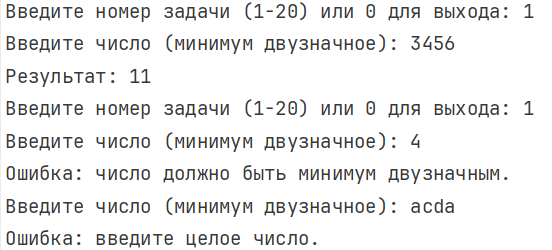

---

## Задача 2. Есть ли позитив

### Текст задачи

Дана сигнатура метода: `public bool isPositive (int x);`

Необходимо реализовать метод таким образом, чтобы он принимал число `x` и возвращал `true`, если оно положительное.

### Алгоритм решения

1. Запросить у пользователя целое число `x`.
2. Сравнить `x` с нулём: если `x > 0` — вернуть `true`, иначе `false`.
3. Вывести результат на экран.

### Тестирование

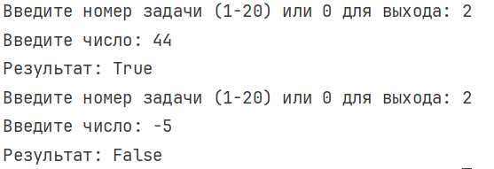
---

## Задача 3. Большая буква

### Текст задачи

Дана сигнатура метода: `public bool isUpperCase (char x);`

Необходимо реализовать метод таким образом, чтобы он принимал символ `x` и возвращал `true`, если это большая буква в диапазоне от `'A'` до `'Z'`.

### Алгоритм решения

1. Запросить у пользователя ровно один символ.
2. Проверить, находится ли символ в диапазоне от `'A'` до `'Z'`.
3. Если да — вернуть `true`, иначе `false`.
4. Вывести результат на экран.

### Тестирование

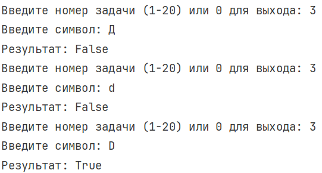

---

## Задача 4. Делитель

### Текст задачи

Дана сигнатура метода: `public bool isDivisor (int a, int b);`

Необходимо реализовать метод таким образом, чтобы он возвращал `true`, если любое из принятых чисел делит другое нацело.

### Алгоритм решения

1. Запросить два целых числа `a` и `b` с проверкой, что ни одно из них не равно нулю.
2. Проверить, равен ли остаток от деления `a` на `b` нулю, либо остаток от деления `b` на `a` нулю.
3. Если хотя бы одно условие выполняется — вернуть `true`, иначе `false`.
4. Вывести результат на экран.

### Тестирование

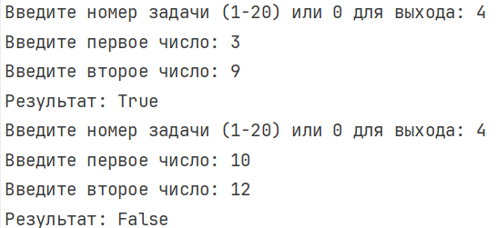

---

## Задача 5. Многократный вызов

### Текст задачи

Дана сигнатура метода: `public int lastNumSum(int a, int b)`

Необходимо реализовать метод таким образом, чтобы он считал сумму цифр двух чисел из разряда единиц. Выполните с его помощью последовательное сложение пяти чисел и результат выведите на экран. Постарайтесь выполнить задачу, используя минимально возможное количество вспомогательных переменных.

### Алгоритм решения

1. Запросить первое число, сохранить его как накопительную сумму.
2. В цикле от 2 до 5 запрашивать очередное число `x`.
3. Вычислять сумму последних цифр текущего накопленного значения и введённого числа.
4. Записывать результат обратно в накопительную переменную.
5. По окончании цикла вывести итоговую сумму на экран.

### Тестирование

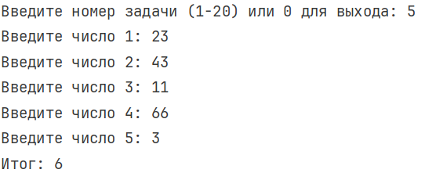

---

# Задание 2

## Задача 1. Безопасное деление

### Текст задачи

Дана сигнатура метода: `public double safeDiv (int x, int y);`

Необходимо реализовать метод таким образом, чтобы он возвращал деление `x` на `y`, и при этом гарантировал, что не будет выкинута ошибка деления на 0. При делении на 0 следует вернуть из метода число 0.

### Алгоритм решения

1. Запросить у пользователя делимое `x` и делитель `y`.
2. Если `y == 0` — вернуть 0.
3. Иначе выполнить приведение `x` к типу `double` и разделить на `y`.
4. Вывести результат на экран.

### Тестирование

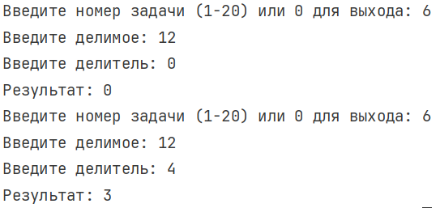

---

## Задача 2. Строка сравнения

### Текст задачи

Дана сигнатура метода: `public String makeDecision (int x, int y);`

Необходимо реализовать метод таким образом, чтобы он возвращал строку, которая включает два принятых методом числа и корректно выставленный знак операции сравнения (больше, меньше, или равно).

### Алгоритм решения

1. Запросить два целых числа `x` и `y`.
2. Если `x > y` — вернуть строку вида `"x > y"`.
3. Если `x < y` — вернуть строку вида `"x < y"`.
4. Иначе — вернуть строку вида `"x == y"`.
5. Вывести результат на экран.

### Тестирование

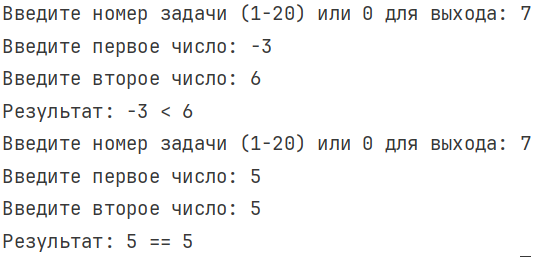

---

## Задача 3. Тройная сумма

### Текст задачи

Дана сигнатура метода: `public bool sum3 (int x, int y, int z);`

Необходимо реализовать метод таким образом, чтобы он возвращал `true`, если два любых числа (из трех принятых) можно сложить так, чтобы получить третье.

### Алгоритм решения

1. Запросить три целых числа `x`, `y`, `z`.
2. Проверить три условия: `x + y == z`, `x + z == y`, `y + z == x`.
3. Если хотя бы одно из условий выполняется — вернуть `true`, иначе `false`.
4. Вывести результат на экран.

### Тестирование

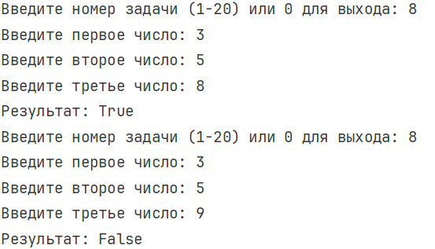

---

## Задача 4. Возраст

### Текст задачи

Дана сигнатура метода: `public String age (int x);`

Необходимо реализовать метод таким образом, чтобы он возвращал строку, в которой сначала будет число `x`, а затем одно из слов:

- год
- года
- лет

Слово "год" добавляется, если число `x` заканчивается на 1, кроме числа 11.

Слово "года" добавляется, если число `x` заканчивается на 2, 3 или 4, кроме чисел 12, 13, 14.

Слово "лет" добавляется во всех остальных случаях.

### Алгоритм решения

1. Запросить у пользователя неотрицательное целое число `x`.
2. Найти последние две цифры числа (`x % 100`) и последнюю цифру (`x % 10`).
3. Если последние две цифры в диапазоне 11–14 — вернуть число и слово "лет".
4. Иначе если последняя цифра равна 1 — вернуть число и слово "год".
5. Иначе если последняя цифра 2, 3 или 4 — вернуть число и слово "года".
6. Иначе — вернуть число и слово "лет".
7. Вывести результат на экран.

### Тестирование

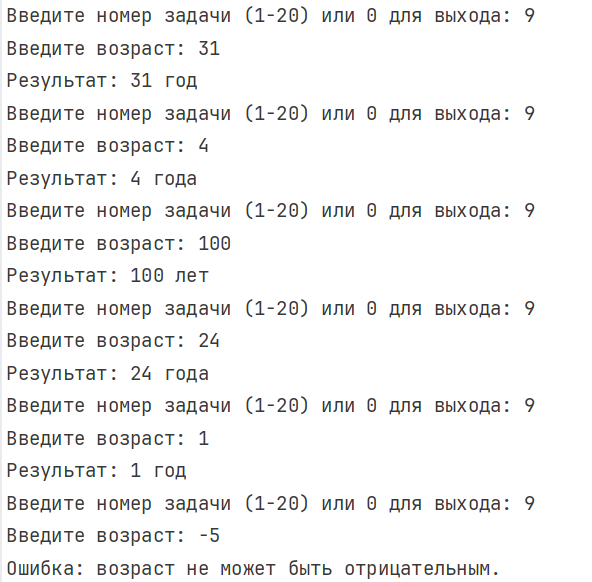

---

## Задача 5. Вывод дней недели

### Текст задачи

Дана сигнатура метода: `public void printDays (String x);`

В качестве параметра метод принимает строку, в которой записано название дня недели. Необходимо реализовать метод таким образом, чтобы он выводил на экран название переданного в него дня и всех последующих до конца недели дней. Если в качестве строки передан не день, то выводится текст "это не день недели". Первый день — понедельник, последний — воскресенье. Вместо `if` в данной задаче используйте `switch`.

### Алгоритм решения

1. Запросить у пользователя название дня недели, привести строку к нижнему регистру.
2. С помощью оператора `switch` и конструкции `goto case` вывести название введённого дня и всех последующих до воскресенья.
3. Если введено не название дня недели — вывести сообщение об ошибке.

### Тестирование

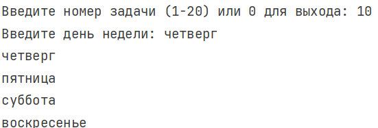

---

# Задание 3

## Задача 1. Числа наоборот

### Текст задачи

Дана сигнатура метода: `public String reverseListNums (int x);`

Необходимо реализовать метод таким образом, чтобы он возвращал строку, в которой будут записаны все числа от `x` до 0 (включительно).

### Алгоритм решения

1. Запросить у пользователя целое число `x`.
2. Создать пустую строку для результата.
3. Если `x >= 0` — в цикле от `x` до 0 добавлять числа в строку через пробел.
4. Если `x < 0` — в цикле от `x` до 0 добавлять числа в строку через пробел.
5. Вернуть получившуюся строку и вывести её на экран.

### Тестирование

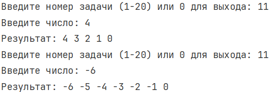

---

## Задача 2. Степень числа

### Текст задачи

Дана сигнатура метода: `public int pow (int x, int y);`

Необходимо реализовать метод таким образом, чтобы он возвращал результат возведения `x` в степень `y`.

### Алгоритм решения

1. Запросить у пользователя основание `x` и степень `y` (с проверкой, что `y >= 0`).
2. Создать переменную результата, равную 1.
3. В цикле от 0 до `y - 1` умножать результат на `x`.
4. Вернуть полученный результат и вывести на экран.

### Тестирование

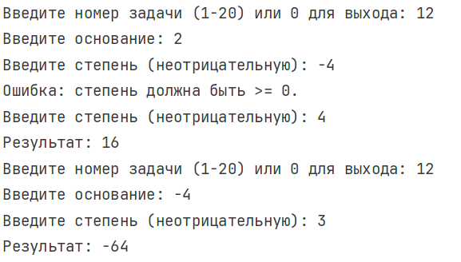

---

## Задача 3. Одинаковость

### Текст задачи

Дана сигнатура метода: `public bool equalNum (int x);`

Необходимо реализовать метод таким образом, чтобы он возвращал `true`, если все знаки числа одинаковы, и `false` в ином случае.

### Алгоритм решения

1. Запросить у пользователя целое число `x`.
2. Если число отрицательное — взять его по модулю.
3. Запомнить последнюю цифру числа, отделить её (`x = x / 10`).
4. В цикле сравнивать каждую следующую цифру с запомненной; при первом несовпадении вернуть `false`.
5. Если цикл завершился — вернуть `true`.
6. Вывести результат на экран.

### Тестирование

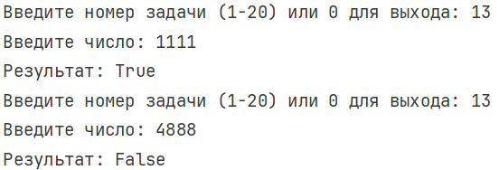

---

## Задача 4. Левый треугольник

### Текст задачи

Дана сигнатура метода: `public void leftTriangle (int x);`

Необходимо реализовать метод таким образом, чтобы он выводил на экран треугольник из символов `'*'`, у которого `x` символов в высоту, а количество символов в ряду совпадает с номером строки.

### Алгоритм решения

1. Запросить у пользователя высоту треугольника `x` (с проверкой, что `x > 0`).
2. Создать пустую строку.
3. В цикле от 0 до `x - 1` добавлять к строке один символ `'*'` и выводить получившуюся строку на экран.

### Тестирование

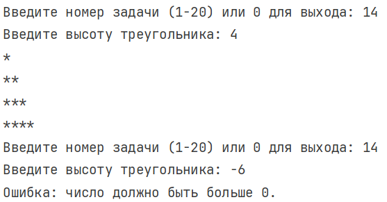

---

## Задача 5. Угадайка

### Текст задачи

Дана сигнатура метода: `public void guessGame()`

Необходимо реализовать метод таким образом, чтобы он генерировал случайное число от 0 до 9, далее считывал с консоли введенное пользователем число и выводил, угадал ли пользователь то, что было загадано, или нет. Метод запускается до тех пор, пока пользователь не угадает число. После этого выведите на экран количество попыток, которое потребовалось пользователю, чтобы угадать число.

### Алгоритм решения

1. Создать объект `Random` и сгенерировать случайное число от 0 до 9.
2. Обнулить счётчик попыток.
3. В бесконечном цикле запрашивать у пользователя число от 0 до 9 с проверкой корректности.
4. Увеличивать счётчик попыток.
5. Если введённое число совпало с загаданным — вывести сообщение об успехе и выйти из цикла.
6. Иначе — сообщить, что пользователь не угадал, и продолжить.
7. После выхода из цикла вывести количество попыток с правильным склонением слова.

### Тестирование

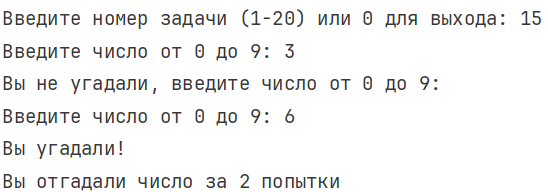

---

# Задание 4

## Задача 1. Поиск последнего значения

### Текст задачи

Дана сигнатура метода: `public int findLast (int[] arr, int x);`

Необходимо реализовать метод таким образом, чтобы он возвращал индекс последнего вхождения числа `x` в массив `arr`. Если число не входит в массив — возвращается `-1`.

### Алгоритм решения

1. Запросить у пользователя размер массива и его элементы.
2. Запросить число `x` для поиска.
3. Инициализировать переменную результата значением `-1`.
4. Пройти по массиву циклом; каждый раз, когда элемент равен `x`, обновлять переменную результата текущим индексом.
5. Вернуть переменную результата и вывести её на экран.

### Тестирование

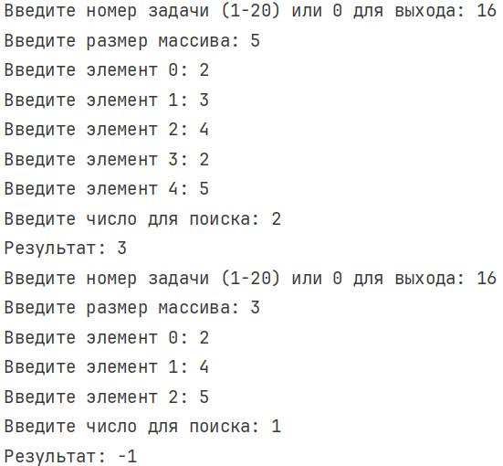

---

## Задача 2. Добавление в массив

### Текст задачи

Дана сигнатура метода: `public int[] add (int[] arr, int x, int pos);`

Необходимо реализовать метод таким образом, чтобы он возвращал новый массив, который будет содержать все элементы массива `arr`, однако в позицию `pos` будет вставлено значение `x`.

### Алгоритм решения

1. Запросить у пользователя размер массива, его элементы, значение `x` и позицию `pos` (с проверкой, что `0 <= pos <= размер массива`).
2. Создать новый массив длиной на 1 больше исходного.
3. Пройти по новому массиву циклом: если индекс равен `pos` — записать туда значение `x`, иначе скопировать очередной элемент исходного массива.
4. Вернуть полученный массив и вывести его на экран.

### Тестирование

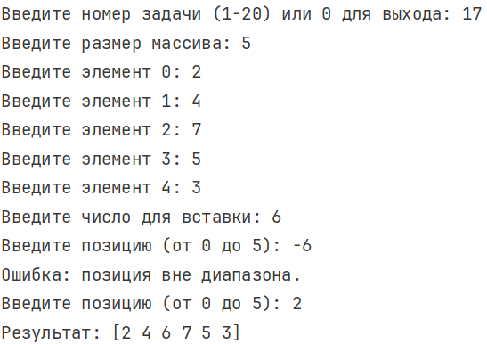

---

## Задача 3. Реверс

### Текст задачи

Дана сигнатура метода: `public void reverse (int[] arr);`

Необходимо реализовать метод таким образом, чтобы он изменял массив `arr`. После проведенных изменений массив должен быть записан задом-наперёд.

### Алгоритм решения

1. Запросить у пользователя размер массива и его элементы.
2. Пройти циклом до середины массива (`arr.Length / 2`).
3. На каждой итерации менять местами текущий элемент и симметричный ему с конца через временную переменную.
4. Вывести получившийся массив на экран.

### Тестирование

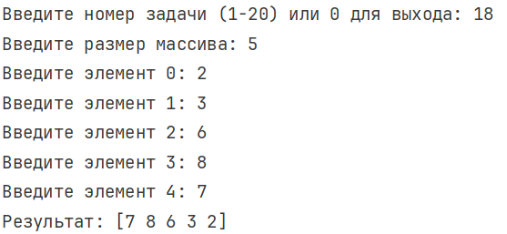

---

## Задача 4. Объединение

### Текст задачи

Дана сигнатура метода: `public int[] concat (int[] arr1, int[] arr2);`

Необходимо реализовать метод таким образом, чтобы он возвращал новый массив, в котором сначала идут элементы первого массива (`arr1`), а затем второго (`arr2`).

### Алгоритм решения

1. Запросить у пользователя размеры и элементы двух массивов.
2. Создать новый массив, длина которого равна сумме длин двух исходных массивов.
3. Скопировать элементы первого массива в начало нового.
4. Скопировать элементы второго массива в новый, начиная с индекса, равного длине первого массива.
5. Вернуть полученный массив и вывести его на экран.

### Тестирование

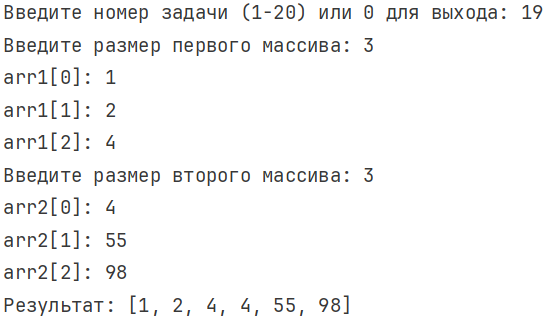

---

## Задача 5. Удалить негатив

### Текст задачи

Дана сигнатура метода: `public int[] deleteNegative (int[] arr);`

Необходимо реализовать метод таким образом, чтобы он возвращал новый массив, в котором записаны все элементы массива `arr` кроме отрицательных.

### Алгоритм решения

1. Запросить у пользователя размер массива и его элементы.
2. Пройти по массиву и посчитать количество неотрицательных элементов.
3. Создать новый массив, длина которого равна этому количеству.
4. Пройти по исходному массиву второй раз и скопировать в новый массив все неотрицательные элементы.
5. Вернуть полученный массив и вывести его на экран.

### Тестирование

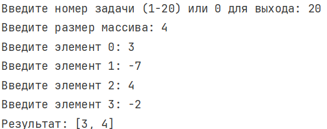

---
